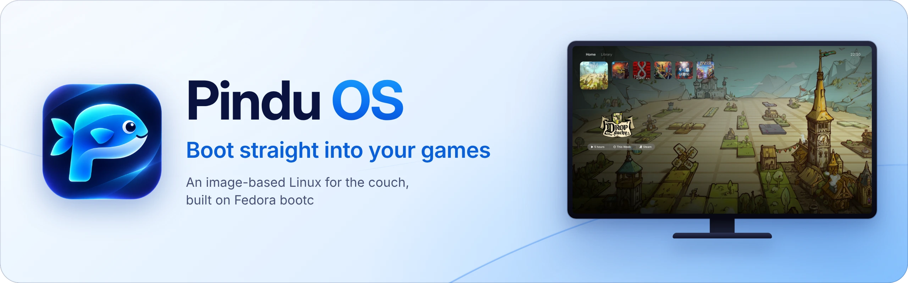
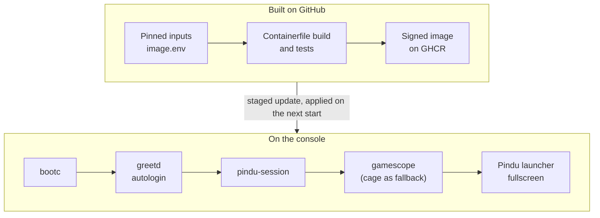

<div align="center">



[Install](#install) · [Features](#features) · [How it works](#how-it-works) · [Documentation](#documentation) ·
[Report a bug](https://github.com/Tim-van-Oudheusden/pindu-os/issues/new) · [Roadmap](#roadmap)

[](https://github.com/Tim-van-Oudheusden/pindu-os/actions/workflows/build.yml)
[](docs/decisions/0001-base-image.md)
[](https://bootc-dev.github.io/bootc/)
[](#images)
[](#signed-and-verifiable)
[](LICENSE)
[](https://github.com/Tim-van-Oudheusden/pindu-os/commits/main)

</div>

## Status

Early development. The image builds, boots in a virtual machine and passes its tests there, and `:testing` builds are
published. It has not been checked on real hardware yet
([#6](https://github.com/Tim-van-Oudheusden/pindu-os/issues/6)), and there is no `:stable` release until installing,
updating and rolling back have been walked through on a PC
([#7](https://github.com/Tim-van-Oudheusden/pindu-os/issues/7)).

## About

Pindu OS turns a PC into a game console: it boots, logs in by itself and shows
[Pindu launcher](https://github.com/Tim-van-Oudheusden/pindu-launcher) fullscreen inside
[gamescope](https://github.com/ValveSoftware/gamescope). It is one x86_64
[bootc](https://bootc-dev.github.io/bootc/) image on Fedora 45, updated as a whole from a container registry and rolled
back the same way.

## Features

- **Straight to your games.** There is no login screen and no desktop. The PC starts, signs in by itself and shows
  Pindu launcher's fullscreen mode, which is made for a controller.
- **Updates that stay out of the way.** An update downloads in the background and takes effect the next time the
  console starts. It never restarts by itself, so it never interrupts a game.
- **Always a way back.** Every update keeps the previous version on disk, and the boot menu starts it again.
- **Signed, and checked on the console.** Every published image carries the project's signature, and a console
  refuses an update without it.
- **Closed by default.** The console image has no SSH server, no sudo and no password. A separate
  [dev image](#images) adds them for test machines.
- **Starts where gamescope cannot.** In a virtual machine or on a GPU without Vulkan, the session falls back to
  [cage](https://github.com/cage-kiosk/cage) and still shows the launcher.
- **Secure Boot stays on.** The image ships Fedora's own kernel. The
  [Open Gaming Collective](https://opengamingcollective.org) kernel is a build option
  ([runbook](docs/runbook.md#ogc-kernel)).
- **Nothing hidden in the build.** One `Containerfile` and a handful of numbered scripts. Nothing is compiled here:
  every input is prebuilt and pinned in [`image.env`](image.env), so a diff of that file explains any change in the
  image.

Not there yet: NVIDIA graphics, setup screens for Wi-Fi and Bluetooth, and preinstalled game stores. The
[roadmap](#roadmap) says what comes next.

## Images

| Image | For | Has |
| --- | --- | --- |
| `ghcr.io/tim-van-oudheusden/pindu-os` | Consoles | No SSH server, no sudo, no password |
| `ghcr.io/tim-van-oudheusden/pindu-os-dev` | Test machines | SSH with keys, passwordless sudo, a shell on VT 2, debugging tools |

Both come in two channels: `:testing` is built from every change and once a day, `:stable` is a tested `:testing`
build. Every build also gets a version tag that never moves, such as `45.20261115.0`.

### Signed and verifiable

Every published image is signed with [cosign](https://github.com/sigstore/cosign), and devices refuse an update that
is not. Each image also carries a build provenance attestation, which ties it to a commit on `main`, and a list of its
contents (an SBOM). The install guide has the two commands that
[check an image yourself](docs/install.md#checking-an-image-yourself).

## Install

> [!WARNING]
> **The installer erases the PC.** It is unattended: once it boots, it wipes every disk in the machine and installs
> without asking a single question. Unplug any disk you want to keep before you start.

You need a 64-bit Intel or AMD PC with UEFI firmware, an AMD or Intel GPU, a network cable, a USB stick of 8 GB or
more, and a controller. Until the first `:stable` release there is no installer to download; `just build-iso` builds
one from this repository.

1. Download the installer ISO from the latest run of the
   [Disk images](https://github.com/Tim-van-Oudheusden/pindu-os/actions/workflows/disk.yml) workflow and check it
   against its `SHA256SUMS`.
2. Write it to the USB stick.
3. Start the PC from the stick and leave it alone for five to ten minutes.
4. Remove the stick when the PC restarts. It boots straight into the launcher.

The [install guide](docs/install.md) has every step in full, and covers updates, rollback, the dev image and
[trying it in a virtual machine](docs/install.md#try-it-in-a-virtual-machine).

## How it works



- **Built from pinned inputs.** The image is Fedora's bootc base image plus a package list, the launcher's release
  RPM, a session script and a handful of configuration files.
- **Tested before it is published.** Every change is linted, built and checked from inside the image, then booted in
  QEMU, where the tests assert on the running session.
- **Booted in one line.** systemd starts [greetd](https://sr.ht/~kennylevinsen/greetd/), which logs the `pindu` user
  in without a greeter and runs `pindu-session`. That starts gamescope, and gamescope starts the launcher.
- **Updated as a whole.** A console replaces its whole system image with the next signed one, and keeps the previous
  one to return to.

[`docs/architecture.md`](docs/architecture.md) describes each part, and [`docs/decisions/`](docs/decisions/README.md)
records why it is built this way.

## Documentation

| I want to… | Read |
| --- | --- |
| Install Pindu OS, update it or roll it back | [Install guide](docs/install.md) |
| Try it without a spare PC | [Try it in a virtual machine](docs/install.md#try-it-in-a-virtual-machine) |
| Fix a console that does not start or update | [When something is wrong](docs/install.md#when-something-is-wrong) |
| Know what is in the image and how it boots | [Architecture](docs/architecture.md) |
| Know why it is built this way | [Decisions](docs/decisions/README.md), one record per design decision |
| Release, rotate the signing key or test on hardware | [Runbook](docs/runbook.md) |
| Read the original plan | [Spec and implementation plan](docs/spec.md) |
| Report a vulnerability, privately | [`SECURITY.md`](SECURITY.md) |
| Use the logo or the banner | [`docs/brand/`](docs/brand/README.md) |

## Building

The build needs `podman`, [`just`](https://just.systems) and `git`. Every pinned input is in [`image.env`](image.env).

```sh
just build            # the production image, as localhost/pindu-os:local
just test             # checks inside the image
just lint             # shellcheck, hadolint, actionlint, zizmor
just build dev && just test dev
```

Disk images need root for [bootc-image-builder](https://github.com/osbuild/bootc-image-builder) (the recipes call
`sudo`), and the VM tests need QEMU with KVM and UEFI firmware (`qemu-system-x86`, `edk2-ovmf`):

```sh
just build-qcow2      # output/prod/qcow2/disk.qcow2
just run-vm           # look at it in a QEMU window
just test-vm          # boot it headless, assert on the session, save a screenshot
just test-update      # stage an update from a local registry, boot it, roll back
just build-iso && just test-install
```

`just --list` shows every recipe.

## Roadmap

1. **First boot on hardware.** The dev image on a PC with an AMD or Intel GPU
   ([#6](https://github.com/Tim-van-Oudheusden/pindu-os/issues/6)).
2. **First `:stable` release.** Install from the ISO, take one update and roll back once
   ([#7](https://github.com/Tim-van-Oudheusden/pindu-os/issues/7)).
3. **Ready for games.** Game stores, a system panel in the launcher for power, network, Bluetooth and updates, a
   boot splash, and variants for handhelds and NVIDIA graphics. The
   [spec](docs/spec.md#phase-3-ready-for-games) lists the work
   packages.

## Contributing

Work is tracked in [GitHub issues](https://github.com/Tim-van-Oudheusden/pindu-os/issues), one issue per pull
request. Bug reports are welcome; report security problems privately as [`SECURITY.md`](SECURITY.md) describes. Code
changes and AI agents follow [`AGENTS.md`](AGENTS.md), which names the checks every pull request passes.

## Acknowledgments

- [Fedora](https://fedoraproject.org) and [bootc](https://github.com/bootc-dev/bootc), the base image and the way it
  is installed and updated.
- [gamescope](https://github.com/ValveSoftware/gamescope) by Valve, [cage](https://github.com/cage-kiosk/cage) and
  [greetd](https://sr.ht/~kennylevinsen/greetd/), which make up the session.
- [Universal Blue](https://universal-blue.org), whose [image-template](https://github.com/ublue-os/image-template)
  shaped this repository and whose [akmods](https://github.com/ublue-os/akmods) images carry the Open Gaming
  Collective kernel.
- [Armada](https://github.com/armada-os/armada), for the layout of numbered build scripts and a pull request
  workflow that never holds a secret.
- [bootc-image-builder](https://github.com/osbuild/bootc-image-builder), which turns the image into disk images and
  the installer.

## Disclaimer

Pindu OS is an independent project. It is not affiliated with or endorsed by the Fedora Project, Red Hat, Valve or
Universal Blue. Product names and trademarks belong to their owners.

## Contact

- [GitHub](https://github.com/Tim-van-Oudheusden)
- [LinkedIn](https://www.linkedin.com/in/tim-van-oudheusden)
- [buildwithtim.dev](https://buildwithtim.dev)
- Other projects: [Pindu launcher](https://github.com/Tim-van-Oudheusden/pindu-launcher), every PC game on your
  machine in one GNOME library, [Dailies](https://github.com/Tim-van-Oudheusden/Dailies), your daily guessing games
  in one GNOME app, and [MinimalUI](https://github.com/Tim-van-Oudheusden/MinimalUI), a minimal Android launcher for
  keyboard-centric phones

## Licence

| Path | Licence |
| --- | --- |
| Code and everything not listed below | [GNU General Public License v3.0 or later](LICENSE) |
| `docs/brand/` | [GPL-3.0-or-later](LICENSE); the text in the images is set in [Inter](https://github.com/rsms/inter), SIL Open Font License 1.1 |

Parts of the repository layout and the build recipes are adapted from
[ublue-os/image-template](https://github.com/ublue-os/image-template) (Apache-2.0) and
[armada-os/armada](https://github.com/armada-os/armada) (GPL-2.0-or-later).
