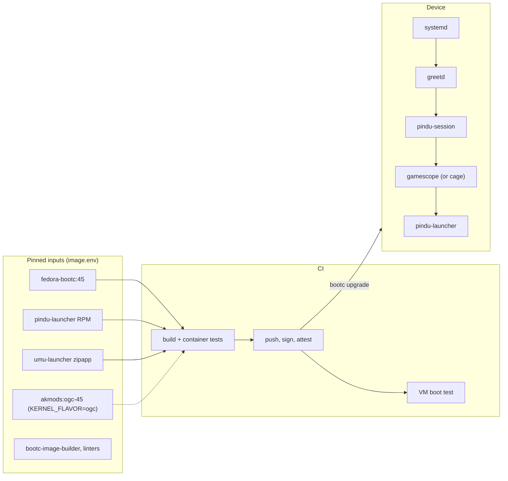

# Architecture

Pindu OS is one x86_64 bootc image. It is Fedora 45's bootc base image plus a package list, one RPM
([pindu-launcher](https://github.com/Tim-van-Oudheusden/pindu-launcher)), one zipapp
([umu-launcher](https://github.com/Open-Wine-Components/umu-launcher)), a session script and a handful of
configuration files. Nothing is compiled in this repository. This page describes what is built and how it boots; the
reasons are in [`decisions/`](decisions/README.md).

## Inputs

Every input is pinned in [`image.env`](../image.env), by digest or by version and SHA-256. Scripts, the `Justfile` and
the workflows read that file; Renovate ([`renovate.json5`](../renovate.json5)) opens the pull requests that change it.

| Pin | What it is |
| --- | --- |
| `FEDORA_VERSION`, `BASE_IMAGE` | `registry.fedoraproject.org/fedora-bootc:45`, the base image |
| `LAUNCHER_VERSION`, `LAUNCHER_SHA256` | The launcher's release RPM on GitHub Releases |
| `UMU_VERSION`, `UMU_SHA256` | umu-launcher's release zipapp on GitHub Releases, which runs the launcher's Windows games |
| `KERNEL_FLAVOR`, `AKMODS_IMAGE` | `fedora` keeps the base kernel; `ogc` takes the Open Gaming Collective kernel from ublue's akmods image |
| `BIB_IMAGE` | bootc-image-builder, for disk images and the ISO |
| `REGISTRY_IMAGE`, `SYFT_IMAGE`, `*LINT*_IMAGE`, `ZIZMOR_IMAGE` | Tools for tests, the SBOM and `just lint` |

`just verify-inputs` checks that every digest resolves, that the base is a Fedora 45 bootc image, that the akmods image
carries Universal Blue's signature and that the launcher RPM and umu's zipapp match their SHA-256.

## Build

The [`Containerfile`](../Containerfile) has four working stages:

- `ctx` holds `build_files/` and `system_files/`. The image stage bind-mounts it, so the scripts never become a layer.
- `launcher` downloads the release RPM and fails unless its SHA-256 matches the pin.
- `umu` downloads umu-launcher's zipapp, fails unless its SHA-256 matches the pin, and keeps only `umu-run`.
- `image` starts from the base image and runs [`build_files/build.sh`](../build_files/build.sh), then
  `bootc container lint --fatal-warnings`.

A fourth, `kernel`, is an alias: an empty stage for `KERNEL_FLAVOR=fedora`, the akmods image for `ogc`. The one that is
not selected is never pulled.

`build.sh` runs the numbered scripts in order, one log group each:

| Script | Does |
| --- | --- |
| `10-repos.sh` | Records the base image's repositories. v0 enables no other: Fedora 45 packages gamescope, cage and greetd. |
| `20-kernel.sh` | Nothing for `fedora`. For `ogc`, replaces the kernel packages with the ones from `/kernel-rpms`. |
| `30-base-packages.sh` | Mesa and Vulkan, firmware, PipeWire, NetworkManager with Wi-Fi, BlueZ, controller udev rules, fonts. Removes `openssh-server` and `sudo`. |
| `40-session-packages.sh` | greetd, gamescope, Xwayland, cage, portals, dconf, gnome-keyring, GStreamer plugins, MangoHud, GameMode, Flatpak, `desktop-file-utils` for store links. |
| `50-launcher.sh` | Installs the launcher RPM and checks its version and libraries. |
| `55-umu.sh` | Installs `umu-run` to `/usr/bin` and checks that it runs and reports the pinned version. |
| `60-system-files.sh` | Copies `system_files/`, creates the `pindu` user, enables greetd, the graphical target and the update timers, disables Fedora's Flatpak remote unit. |
| `70-os-release.sh` | Writes os-release (`ID=pindu-os`, `ID_LIKE=fedora`) and `/usr/share/pindu-os/image-info.json`, rebuilds the initramfs. |
| `80-variant-dev.sh` | Only for `VARIANT=dev`: sshd, sudo, a shell on VT 2, debugging tools. |
| `90-cleanup.sh` | Empties `/var` and `/boot`, then checks the result: one kernel, the boot chain's packages, no added repository, no desktop environment. |

Each package sits in a group with a comment that says why it is there. The arrays in the scripts are the only copy of
the lists; the package test reads them through each script's `--list` mode.

The initramfs is rebuilt because it carries a copy of os-release, and systemd sets the hostname from it before the
real root is mounted. With the base image's initramfs the machine would be called `fedora` instead of `pindu`.

## Boot chain

1. **systemd** boots to `graphical.target`. The kernel arguments in
   [`kargs.d/10-pindu.toml`](../system_files/usr/lib/bootc/kargs.d/10-pindu.toml) keep the boot quiet.
2. **greetd** runs on VT 1. [`/etc/greetd/config.toml`](../system_files/etc/greetd/config.toml) logs the `pindu` user
   in without a greeter (`initial_session`). When the session ends, `default_session` exits at once, greetd exits with
   it, and systemd restarts greetd; a drop-in deletes greetd's runfile before every start, so the restarted greetd logs
   `pindu` in again.
3. **`/usr/bin/pindu-session`** is the login session. It sets `XDG_CURRENT_DESKTOP=gamescope`, hands the session
   environment to the systemd user manager and D-Bus, runs `systemctl --user start --wait pindu-session.service`, and
   takes the display variables back out when the unit ends.
4. **`pindu-session.service`** (a user unit, `Type=notify`) carries `graphical-session.target` and runs
   `pindu-session compositor`:
   - It starts `gamescope --backend drm -- pindu-session client`. If the first connected display is taller than 1080
     lines it adds `-w <width> -h 1080`: under Xwayland the launcher draws at scale 1, so gamescope renders it at 1080
     lines and upscales.
   - A gamescope run shorter than 10 seconds counts as a failed start. After two in a row it runs
     `cage -- pindu-session client` instead. This is what happens in a VM and on a GPU without usable Vulkan.
   - A longer run that ends is the end of the session: the unit stops, the login script returns, and greetd restarts
     and logs `pindu` in again.
5. **`pindu-session client`** runs inside the compositor. It publishes `DISPLAY` or `WAYLAND_DISPLAY` to the user
   manager and D-Bus, tells systemd the unit is ready, and becomes `pindu-launcher --fullscreen`. Under gamescope it
   sets `GDK_BACKEND=x11`, so the launcher and the games it starts are X11 clients on gamescope's Xwayland.

Around the launcher:

- **Portals.** `xdg-desktop-portal` starts on demand once `graphical-session.target` is up.
  [`gamescope-portals.conf`](../system_files/usr/share/xdg-desktop-portal/gamescope-portals.conf) selects the GTK
  backend, under cage too, because the session keeps `XDG_CURRENT_DESKTOP=gamescope`.
- **Sound.** PipeWire, its PulseAudio front end and WirePlumber are user units that Fedora's presets enable.
- **Secrets.** gnome-keyring is the Secret Service provider. The session unit starts it before the launcher, and
  [`tmpfiles.d/pindu.conf`](../system_files/usr/lib/tmpfiles.d/pindu.conf) creates a default keyring without a password
  on first boot ([decision 0010](decisions/0010-keyring.md)).
- **Extra gamescope arguments** for hardware testing go in `PINDU_GAMESCOPE_ARGS`, set with
  `systemctl --user edit pindu-session.service`.

## Users and variants

There is one user, `pindu` (UID 1000), created by [`sysusers.d/pindu.conf`](../system_files/usr/lib/sysusers.d/pindu.conf)
with a locked password. Its home, `/var/home/pindu`, is created on first boot.

| | `pindu-os` (`VARIANT=prod`) | `pindu-os-dev` (`VARIANT=dev`) |
| --- | --- | --- |
| SSH server | Not installed | Enabled, keys only |
| sudo | Not installed | Passwordless for `pindu` (group `wheel`) |
| VT 2 | Nothing | A shell, logged in as `pindu` |
| Tools | None | `nmtui`, `vulkaninfo`, `lspci`, `lsusb`, `evtest`, `libinput`, `secret-tool`, `gdb`, `strace`, `htop`, `tmux` |

A variant is a build argument of the same `Containerfile`: `VARIANT`, `KERNEL_FLAVOR` and `BASE_IMAGE`.

## Game stores and Get Games

No store is preinstalled. The launcher's "add a store" flow installs Steam, Heroic or Lutris as Flatpaks from Flathub
into the system installation ([decision 0013](decisions/0013-game-sources.md)), and its Get Games installs and removes
Flathub's games and a few extras the same way ([decision 0015](decisions/0015-get-games.md)):

- [`flathub.flatpakrepo`](../system_files/usr/share/flatpak/remotes.d/flathub.flatpakrepo) in
  `/usr/share/flatpak/remotes.d` makes `flathub`, with Flathub's signing key, the system installation's only remote.
  flatpak adds it the first time it opens `/var/lib/flatpak`, which tmpfiles.d creates on first boot.
- Fedora's `flatpak-add-fedora-repos.service` is disabled, and
  [`40-pindu-os.preset`](../system_files/usr/lib/systemd/system-preset/40-pindu-os.preset) keeps it disabled through
  the first-boot presets, so the Fedora remote never appears.
- [`50-pindu-os.rules`](../system_files/usr/share/polkit-1/rules.d/50-pindu-os.rules) lets `pindu`, in an active local
  session, install and update apps and runtimes from `flathub` and uninstall apps and runtimes without a password,
  and nothing else Fedora's defaults do not already allow. Those defaults let the session download Flathub's catalogue
  (`flatpak update --appstream --system`), which Get Games reads; adding or changing a remote stays refused.
- `pindu-os-flatpak-update.timer` runs `flatpak update --system --noninteractive`, then
  `flatpak uninstall --system --unused --noninteractive`, 30 minutes after boot and every 12 hours, at idle priority.
  The second removes the runtimes a removed game left behind.
- [`get-games.yaml`](../system_files/usr/share/pindu-launcher/distributor/get-games.yaml) in
  `/usr/share/pindu-launcher/distributor` holds the console's Get Games lists: the categories that count as games, a
  blocklist, extras and picks. Its path and format are a proposal until the launcher's work package GG-2 settles them.
- `steam-devices` provides the controller and `uinput` udev rules that Flatpak Steam needs from the host. MangoHud and
  GameMode are RPMs in the image.

## Updates and trust

- The image is published as `ghcr.io/tim-van-oudheusden/pindu-os` (and `pindu-os-dev`) with three kinds of tag:
  `:testing` (every build), `:stable` (a promoted `:testing` digest) and an immutable `45.YYYYMMDD.N` per build.
- On the device, `bootc-fetch-apply-updates.timer` runs 10 minutes after boot and every 4 hours. A drop-in replaces the
  stock `bootc upgrade --apply`, which reboots, with `bootc upgrade`: the update is downloaded and staged, and takes
  effect on the next boot. `bootc rollback` returns to the previous image.
- The launcher's system panel shows the update state and rolls back without root:
  - `pindu-os-update-status.service` writes `bootc status --format=json --format-version=1` to
    `/run/pindu-os/update-status.json` (mode 0644) at boot, after each successful run of the update service and after
    a rollback.
  - `pindu-os-rollback.service` runs `bootc rollback`, then the status unit. It is never enabled; the launcher starts
    it.
  - [`50-pindu-os.rules`](../system_files/usr/share/polkit-1/rules.d/50-pindu-os.rules) lets `pindu`, in an active
    local session, start that one unit and save system-wide NetworkManager connections without a password (and
    install from Flathub, above). Fedora's defaults already allow the session to power off, reboot, suspend, control
    the network and scan for Wi-Fi.
- CI signs each pushed digest with a cosign key. The image carries the public key
  (`/etc/pki/containers/pindu-os.pub`) and [`policy.json`](../system_files/etc/containers/policy.json), which makes
  the container tools refuse an image from our two repositories unless it has that signature. The installer sets the
  installed system to enforce the policy (`bootc switch --enforce-container-sigpolicy`).
- Each image also gets a GitHub build provenance attestation and an SBOM attestation, which need no key.
- Until the key pair exists ([runbook](runbook.md#signing-key)), a build leaves the policy out and says so, and
  `build.yml` refuses to publish.

## CI

All workflows run on GitHub-hosted runners. Code from a pull request never runs in a job that holds a secret or a
write token.

| Workflow | Trigger | Does | Token |
| --- | --- | --- | --- |
| [`pr.yml`](../.github/workflows/pr.yml) | `pull_request` | `just lint` and `just test-ci`; for both variants: build, container tests, qcow2, VM boot test, screenshot artifact | `contents: read`, no secrets, no registry login |
| [`build.yml`](../.github/workflows/build.yml) | Push to `main`, daily, manual | Verifies the pins, builds both variants, pushes `:testing` and the version tag, signs, attests provenance and an SBOM, boots the published digest in a VM | `packages: write`, `id-token: write`, `attestations: write`; the key is in the `signing` environment |
| [`disk.yml`](../.github/workflows/disk.yml) | Manual, and after a promotion | Verifies the signature of a tag or digest, builds qcow2, raw and ISO with bootc-image-builder, tests the qcow2 and the ISO in QEMU | `packages: read` |
| [`promote.yml`](../.github/workflows/promote.yml) | Manual, behind the `promote` environment | Verifies the signature of a `:testing` (or version) tag, refuses a new launcher without a passed hardware check ([decision 0012](decisions/0012-launcher-releases.md)) and retags the same digest `:stable`, for both variants | `packages: write` |

Actions are pinned by commit SHA. `.github/CODEOWNERS` requests the maintainer's review on `.github/`, `image.env`, the
signature policy and the agent instructions.

## Tests

- **Container tests** ([`tests/container/`](../tests/container)) run inside the built image with `just test`: the
  package lists, the launcher's version and libraries, the session script against stub compositors (fallback after two
  failed gamescope starts, none when gamescope stays up, the 1080-line render size), the user and autologin
  configuration, the variant's access rules, the signature policy, the update units, and the Flatpak remote, the
  disabled Fedora remote unit, the controller rules, the Flatpak update units (including that an unused runtime is
  removed and a used one stays) and the Get Games lists.
- **Workflow script tests** ([`tests/ci/`](../tests/ci)) run on the host with `just test-ci`: the promote gate
  against a stub registry and stub launcher issues, with `image.env` from a scratch git repository.
- **VM tests** ([`tests/vm/`](../tests/vm)) boot real disk images in QEMU with KVM and UEFI firmware. The assertions
  run inside the guest: the host passes a unit and a script as systemd credentials on QEMU's SMBIOS table, and the
  script reports on a serial port. The image under test is therefore unmodified, and the production image is tested
  without an SSH server.
  - `boot.sh`: a `pindu` session on seat0 within 60 seconds of boot, a locked password, `pindu-session.service`
    active, a `pindu-launcher` process, sound, a portal that answers, a keyring that opens without a prompt, polkit's
    answers for the system panel and for installing and uninstalling from Flathub, a catalogue download as `pindu`,
    no remote added by `pindu`, `flathub` in `pindu`'s view of the system installation, and a screenshot that is not
    blank. With `--ssh` (dev image): SSH with an injected key, and sudo.
  - `update.sh`: four boots. The guest switches to the image as served by a local registry, the host pushes a newer
    one, the update service stages it without a reboot, the next boot runs it, and `bootc rollback` returns.
  - `install.sh`: three installer runs. With two empty disks the installer must refuse and write nothing; with one disk
    and the answer "no" it must power off and write nothing; with one disk confirmed by the credential
    `pindu.install.confirm` it installs, and `boot.sh` then runs on the installed disk.

## Known limits

- **A VM cannot prove gamescope.** A virtual GPU has no Vulkan, so the VM tests exercise the cage fallback. gamescope
  on the DRM backend is checked on hardware ([runbook](runbook.md#testing-on-hardware)).
- **Focus without `--steam`.** In plain gamescope a game window takes focus and hands it back. Games that open a
  launcher window first (Steam titles) are untested; the fix is the launcher speaking gamescope's window protocol
  ([pindu-launcher#377](https://github.com/Tim-van-Oudheusden/pindu-launcher/issues/377)).
- **Wi-Fi in the launcher is for home networks.** Quick Access joins open and WPA/WPA2/WPA3 personal networks.
  Enterprise (802.1X) and hidden networks, static addresses, VPNs and proxies need `nmtui` on the dev image.
- **A raw image does not grow on bare metal.** Fedora's `bootc-generic-growpart.service` only runs in VMs. Install on
  PCs from the ISO.
- **The keyring is not encrypted**, and neither is the disk ([decision 0010](decisions/0010-keyring.md)).
